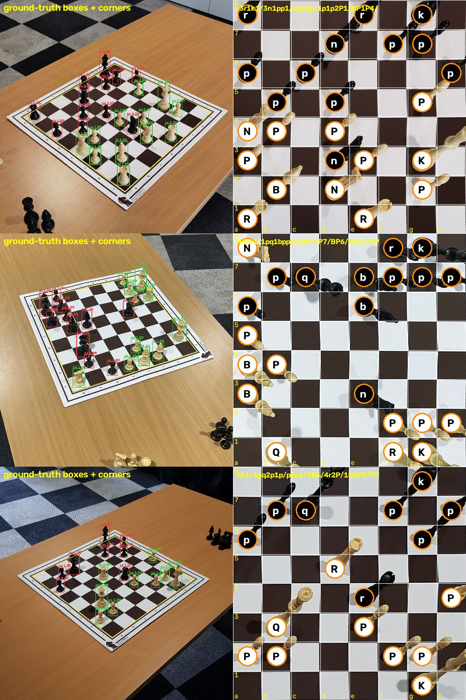
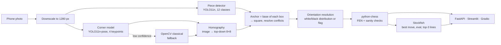
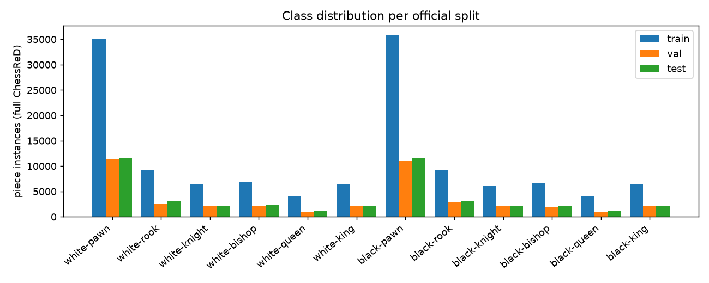

# ♟️ ChessVision — photo-to-position chess recognition

[](https://github.com/Tusshar05/chess-vision/actions/workflows/ci.yml)
[](LICENSE)

Take a phone photo of a **physical chessboard** and get back the position as **FEN**, plus
**Stockfish's best move and evaluation**. Two small YOLO11 models (pieces + board corners) feed a
homography that maps every piece to its square; everything runs on **CPU** through ONNX Runtime
(FP32 / INT8, CoreML export for iPhone) behind a FastAPI service, a Streamlit dashboard and a
Gradio demo.

> ⚠️ **Smoke-test weights ≠ results.** With the tiny smoke weights the API's `/health` reports
> `kind: smoke`, and the dashboard and demo show a banner **“Smoke-test weights loaded — results not
> meaningful”**.

> **Status:** the full system is built and tested end to end. Model **training happens on a free
> Colab T4** (`notebooks/train_colab.ipynb`); until the trained weights are added, the repo runs
> with tiny *smoke-test* weights that prove the pipeline but are **not accurate**. Result tables
> below show *Pending* until `make weights eval export bench report` has been run with the trained
> weights — no number in this README is invented or comes from smoke weights.



*The position-reconstruction stage driven by **ground-truth** boxes and corners (not model output):
left, the photo; right, the homography-warped top-down board with each piece assigned to its square.*

## How it works



1. **Corners** — a YOLO11n-pose model predicts the 4 board corners (OpenCV edge/contour baseline as fallback and as a comparison).
2. **Pieces** — a YOLO11n detector finds 12 classes (white/black × K Q R B N P).
3. **Geometry** — the corners define a homography to a top-down 8×8 grid; each piece's *base*
   (bottom-centre of its box, since pieces are tall) is projected into it. Two pieces on one square
   → the more confident one wins. Pieces outside the board (captured pieces) are dropped.
4. **Orientation** — photos are taken from all four sides; the layout of white vs black pieces picks
   the rotation (or you pass `rotation`).
5. **FEN + validation** — python-chess builds the FEN and flags impossible positions (missing
   kings, pawns on rank 1/8, too many pieces, side-not-to-move in check, …).
6. **Stockfish** — run as a separate UCI process for best move, evaluation and top lines.

## Features

- REST API: `/v1/recognize`, `/v1/analyze`, `/v1/recognize-and-analyze`, `/v1/history`, `/health` (reports whether **smoke or trained** weights are loaded), `/metrics` (Prometheus), OpenAPI docs at `/docs`.
- Dashboard: upload, detection overlay, top-down view, **editable FEN**, Stockfish analysis, Lichess link, history.
- Edge-ready: ONNX FP32 + static INT8, CoreML export, no PyTorch in the serving image ([docs/EDGE.md](docs/EDGE.md)).
- Reproducible evaluation: split **by game** (no leakage), per-class metrics, confusion matrix, board-level accuracy, failure gallery, ablations (640 vs 960, n vs s, learned vs classical corners).
- Docker Compose, Kubernetes manifests (schema-validated), GitHub Actions CI/CD to GHCR, Hugging Face Spaces demo bundle.

## Quickstart

### Local (macOS / Linux)
```bash
git clone https://github.com/Tusshar05/chess-vision.git && cd chess-vision
brew install uv stockfish            # or: apt install stockfish
make setup                           # Python 3.11 venv + dependencies
make data                            # annotations + small sample + 306 test images (~1.2 GB, a few minutes)
make smoke-train                     # tiny CPU training run -> weights/*_smoke.pt   (pipeline test only)
make export                          # ONNX FP32 / INT8 / CoreML -> weights/
make test                            # unit + API tests with coverage
.venv/bin/uvicorn services.api.app.main:app_factory --factory --port 8000
.venv/bin/streamlit run services/dashboard/app.py
```

### Docker
```bash
make up                              # API on :8000, dashboard on :8501 (weights/ is a mounted volume)
curl -F file=@samples/G033_IMG034.jpg localhost:8000/v1/recognize-and-analyze
make down
```
Swapping smoke → trained weights needs no rebuild: `make weights export && docker compose restart api`.

### Get real accuracy
Follow [docs/RUN_ORDER.md](docs/RUN_ORDER.md): train on Colab (free T4, ~2.5 h), put the weights
zip in `release_assets/`, run `make weights eval export bench report`.

## Results

All tables are generated from `reports/` by `make report`.

### Dataset (computed from the annotation file)
<!-- DATASET:START -->
| split | images | games | piece instances |
|---|---|---|---|
| train | 6,479 | 60 | 136,594 |
| val | 2,192 | 20 | 42,939 |
| test | 2,129 | 20 | 44,271 |

Boxes and corners exist only for ChessReD2K (2,078 images: train 1442 / val 330 / test 306); detector and corner models train on it. Splits are by game (verified at every data-prep run).


<!-- DATASET:END -->

### Geometry stage ceiling (no model involved)
<!-- GEOMETRY:START -->
| anchor | boards, 0 errors | mean errors / board | auto-orientation |
|---|---|---|---|
| bottom_centre (lift 0.00) | 98.69% | 0.0261 | 96.41% |
| lift 0.10 | 100.0% | 0.0 | 96.41% |
| lift 0.20 | 98.69% | 0.0359 | 96.41% |

306 ChessReD2K test images, ground-truth boxes and corners.
<!-- GEOMETRY:END -->

With *perfect* detections and corners, the homography + square assignment gets (almost) every board
right, so remaining errors in the full system come from the models. The 0.10 anchor lift (a piece's
base sits slightly above its box's bottom edge) was chosen among three values on these same images
(`ml/geometry_oracle.py`).

### Trained models: detector, end-to-end, corners vs baseline
<!-- RESULTS:START -->
_Pending — run Colab training and `make weights eval export bench report` (see [docs/RUN_ORDER.md](docs/RUN_ORDER.md))._
<!-- RESULTS:END -->

### Training runs (Colab T4)
<!-- TRAINING:START -->
_Pending — run Colab training and `make weights eval export bench report` (see [docs/RUN_ORDER.md](docs/RUN_ORDER.md))._
<!-- TRAINING:END -->

### CPU benchmark
<!-- BENCH:START -->
_Pending — run Colab training and `make weights eval export bench report` (see [docs/RUN_ORDER.md](docs/RUN_ORDER.md))._
<!-- BENCH:END -->

## Comparison with the ChessReD paper
The dataset paper (Masouris & van Gemert, *End-to-End Chess Recognition*, VISAPP 2024) reports
**15.26 %** of boards recognised with zero errors on the full test split using an end-to-end CNN
that predicts the whole board. This project uses a different, detection + geometry pipeline and is
evaluated on the **306-image ChessReD2K test subset** (3 games; the only part with box/corner labels), so
the comparison is indicative, not controlled. The paper's other metrics are not quoted because I
have not independently verified them.

## Limitations (honest)
- Needs the whole board in view; heavy occlusion (a hand over the board) or extreme angles hurt.
- Orientation auto-detection fails on sparse endgames (96.4 % even with perfect detections) →
  `rotation` override in the API/UI.
- A photo cannot reveal side to move, castling rights or en-passant: turn is a parameter, castling
  is inferred from home squares, en-passant is never set.
- The evaluation set is small: 306 images from only **3 games** (ChessReD2K test), so treat
  percentages as indicative.
- Trained on one dataset (one board and piece set, 3 phones) → expect a domain gap on other sets.
- Look-alike pieces (bishop/pawn at steep angles) are the expected main confusion; see the confusion matrix.
- SQLite history supports a single API replica (see [deploy/k8s/README.md](deploy/k8s/README.md)).
- Jetson/TensorRT path is documented but **untested**; Kubernetes manifests are schema-validated only.

## Future work
Video: track moves across frames (temporal consistency, legal-move filtering → game recording /
PGN), per-square re-classification crops, learned orientation head, active learning on failures,
on-device iPhone app, Postgres for multi-replica history.

## Repository map
```
ml/                 data pipeline, training, evaluation, export, benchmark, chessvision/ (inference lib)
services/api        FastAPI service       services/dashboard   Streamlit UI
demo/               Gradio / HF Spaces    deploy/k8s           Kubernetes manifests
notebooks/          Colab training        configs/             training run configs
reports/            generated results     docs/                learning guide, interview prep, decisions
```
Docs: [LEARNING](docs/LEARNING.md) · [INTERVIEW_PREP](docs/INTERVIEW_PREP.md) · [DECISIONS](docs/DECISIONS.md) · [EDGE](docs/EDGE.md) · [DEPLOY_DEMO](docs/DEPLOY_DEMO.md) · [RUN_ORDER](docs/RUN_ORDER.md) · [RESUME](docs/RESUME.md)

## Licenses and citations
- **Code in this repository: AGPL-3.0** ([LICENSE](LICENSE)), because it depends on Ultralytics YOLO.
- **Dataset, `samples/` images and any trained weights: CC BY-NC-SA 4.0** — attribution,
  **non-commercial**, share-alike. The weights are trained on ChessReD, so they inherit this. Full
  notice and attribution: [LICENSE-DATA-AND-WEIGHTS.md](LICENSE-DATA-AND-WEIGHTS.md). GitHub
  Releases and Hugging Face Spaces carrying the weights must repeat it.
- **Dataset provenance:** the brief said CC BY 4.0, but the 4TU.ResearchData record lists
  CC BY-NC-SA 4.0; I follow the source record ([docs/DECISIONS.md](docs/DECISIONS.md)).
- **Ultralytics YOLO11:** AGPL-3.0. **Stockfish:** GPL-3.0, run as a separate binary over UCI.

```bibtex
@inproceedings{masouris2024chessred,
  title     = {End-to-End Chess Recognition},
  author    = {Masouris, Athanasios and van Gemert, Jan},
  booktitle = {Proceedings of the 19th International Joint Conference on Computer Vision, Imaging and Computer Graphics Theory and Applications (VISAPP)},
  pages     = {393--403},
  year      = {2024},
  doi       = {10.5220/0012370200003660}
}
@misc{chessred_data,
  title     = {Chess Recognition Dataset (ChessReD)},
  author    = {Masouris, Athanasios and van Gemert, Jan},
  publisher = {4TU.ResearchData},
  doi       = {10.4121/99b5c721-280b-450b-b058-b2900b69a90f.v2}
}
```
Reference implementation: <https://github.com/ThanosM97/end-to-end-chess-recognition>.
