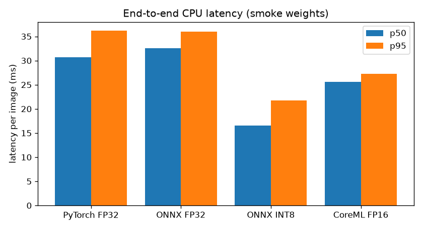

> **SMOKE-TEST WEIGHTS - latency is representative of the architecture, accuracy numbers are meaningless and must not be quoted.**

# CPU benchmark

- Machine: Apple M3 Pro (11 physical cores, 18 GB), macOS-27.0.1-arm64-arm-64bit
- Python 3.11.18, torch 2.15.0, onnxruntime 1.31.1
- 20 ChessReD2K test images, whole pipeline per image (corner model + detector + geometry), image pre-decoded; ORT threads: default

| Backend | p50 ms | p95 ms | boards 0 errors % | mean errors / board |
|---|---|---|---|---|
| PyTorch FP32 | 30.7 | 36.2 | 0.0 | 21.9 |
| ONNX FP32 | 32.6 | 36.0 | 0.0 | 22.0 |
| ONNX INT8 | 16.5 | 21.7 | 0.0 | 21.8 |
| CoreML FP16 | 25.6 | 27.3 | 0.0 | 21.9 |

Model sizes (MB):

| Model | ONNX FP32 | ONNX INT8 |
|---|---|---|
| detector (imgsz 320) | 10.55 | 3.15 |
| corners (imgsz 320) | 10.8 | 3.25 |

